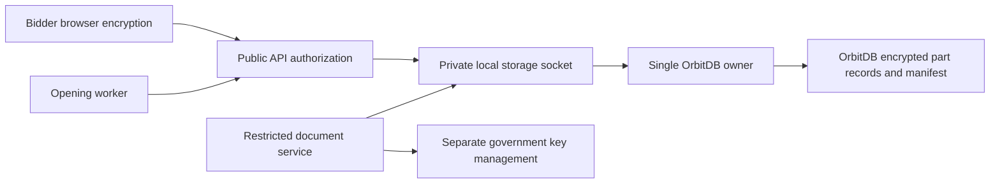

# OrbitDB encrypted document storage

Runtime dependencies are installed and locked as of 13 November 2026. STORAGE_PROVIDER=orbitdb is configured in backend/.env. Actual-engine persistence across processes and independent decryption passed. The real EVM tender workflow now passes 15 checks using a direct OrbitDB adapter, from signed upload through opening, restricted viewing and final approval. Deployment remains unverified: the socket workflow fails with `listen EPERM`, and the configured database was previously observed locked by another process. No successful import or service restart is claimed.

## What is stored

The application writes the actual encrypted bid contents into OrbitDB Documents records. Each part record contains ciphertext, nonce, wrapped encryption material, evidence hashes, public-key fingerprint and its chain, workflow, tender, bidder and version context. Its key is the existing bundle content ID plus the part number. A small bundle manifest records the part numbers after all part records are written. The database holds document contents, not just file paths or external content identifiers.

The three required parts are separate records, preserving the existing 1 MiB plaintext-per-part limit. Canonical encrypted packages remain capped at 6 MiB. Records are verified against their content ID when reconstructed and against blockchain evidence before opening or viewing. SHA-256 IDs, wallet authorizations, blockchain transactions and existing encrypted backups retain their format. A database write does not submit or accept a bid.

Private government decryption keys remain outside the database. The database directory contains OrbitDB's own signing identity and persistent blocks; do not expose it as a static directory or mount it into the public API. Plaintext filenames and file contents remain encrypted.

OrbitDB uses Helia/IPFS internally. This implementation has no separate file-upload gateway, pinning provider or application-managed replication. Database synchronization is disabled with `sync: false`; bootstrap discovery, listening peer addresses, external routers and block brokers are disabled. This is a single local instance of a decentralized database technology. It does not demonstrate a distributed deployment or storage fault tolerance.

## Process architecture

One storage process owns the OrbitDB/LevelDB files. The public API and restricted document service use a private Unix socket to reach that same process. This avoids simultaneous database locks and independent unsynchronized copies. The storage owner handles encrypted records only; it never loads government opening keys or decrypts documents.



`STORAGE_PROVIDER=orbitdb` selects the socket-backed adapter. If the owner is absent, requests fail with ORBITDB_UNAVAILABLE; there is no automatic fallback to JSON files. `filesystem` explicitly selects the compatibility adapter. The document service creates a read-only database client. Socket mode is 0600 and its default parent directory is private. The local OS account is trusted: its administrator can access the underlying records, as with the previous filesystem implementation. Client-side read-only mode is an application safeguard, not a separate OS identity boundary.

## Install and validate before switching

Use a current Node.js 24 release (at least 24.3; installation under 24.2 emits transitive React Native and Metro engine warnings). From the project root:

```bash
npm run orbitdb:install
npm run test:orbitdb:live
```

Dependencies are isolated under backend/orbitdb-runtime so ordinary frontend/backend installation and existing builds continue to work without the optional runtime. The manifest pins OrbitDB 4.0.0, Helia 6.0.22, blockstore-level 3.0.2, gossipsub 15.0.16 and identify 4.0.5 using the upstream OrbitDB development dependency family. Installation completed and the generated runtime package-lock.json is retained. Engine persistence and the direct-adapter EVM workflow passed separately; deployed socket and application validation remain pending.

The live test is explicit and does not silently skip missing dependencies. It writes three maximum-size synthetic bid parts using the actual engine, closes it, reads the records in a separate process, then exercises the private socket with API and viewer clients. It verifies decryption, stable database address, zero connected database peers, restrictive socket permissions and owner-lock conflict handling. Passing ordinary adapter tests does not establish that this live test passes.

## Start the database owner

In its own terminal from the project root:

```bash
npm run orbitdb:start
```

Keep it running. The default database directory is backend/orbitdb-data. It must be a private regular directory with mode 0700. Database blocks, signing identity, heads and database address configuration persist there. Do not delete or regenerate this directory on restart. The default socket is backend/orbitdb-data/storage.sock.

In another terminal:

```bash
npm run orbitdb:status
```

The command prints the database address and synchronization mode, never keys or document contents. ORBITDB_DIR selects the owner's persistent directory. If ORBITDB_SOCKET is overridden, set the same absolute socket path for owner, API, viewer and import commands. Unix socket paths must be at most 100 bytes; use a shorter private directory when necessary.

An existing socket is never unlinked automatically. If startup reports a conflict, stop the existing owner. After a crash, verify that no owner remains before removing a stale socket. Preserve the database directory. Clean shutdown waits for in-flight operations before closing OrbitDB.

## Import existing encrypted packages

Stop the API and document service so uploads cannot race the migration. Leave the OrbitDB owner running. From the project root:

```bash
npm run orbitdb:import
```

This reads the existing STORAGE_DIR, validates each canonical encrypted package and its SHA-256 content ID, writes it to OrbitDB and verifies it again. It retains every source file. A corrupt source stops the import; already completed imports remain and exact retries are idempotent. Inspect and resolve the failure before switching providers. Import does not deploy contracts, alter tender versions, replace keys or change blockchain evidence.

After a successful live test and complete import, set this in backend/.env:

```dotenv
STORAGE_PROVIDER=orbitdb
```

Keep the configured contract addresses, public-key directory and private custody settings. Ensure backend/.env.documents does not override the provider/socket inconsistently. Restart the API and restricted document service:

```bash
npm run dev
```

In a separate terminal:

```bash
npm --prefix backend run documents:dev
```

Keep the existing Hardhat node running. No new Solidity deployment is required solely for this storage integration. The earlier opening-policy migration remains a separate requirement if policy 2 is not yet deployed.

## Verification and limitations

The adapter suite uses a Documents API double, including property reordering to represent DAG-CBOR decoding. It covers direct ciphertext records, maximum-size encryption, idempotent concurrent retries, interrupted writes, altered or missing parts, quotas, strict schema checks, exact content IDs and the existing signed upload/opening/audited-viewing services. These are application-level checks, not actual OrbitDB persistence results.

The owner writes part records before the manifest; interrupted partial records are not listed as completed packages and count toward capacity. The normal limit is 1000 packages and 256 MiB of serialized database records. This bounds application payloads, not total LevelDB disk overhead. No automatic retention, deletion, compaction or backup policy is introduced.

Actual runtime loading, native database writes, process persistence and independent decryption have passed. The workflow suite supports three explicit storage modes; the existing filesystem regression retains its 14 checks. From the project root:

```bash
npm run test:orbitdb:workflow
npm run test:orbitdb:socket-workflow
```

The first command uses the actual OrbitDB engine directly with isolated real Hardhat contracts and injected HTTP handlers. Its 15 checks cover signed HTTP uploads, initial/technical/financial opening and cryptographic verification, commission-only viewing, audit and replay controls, corruption, role revocation and final approval. It verifies exact encrypted package reconstruction and zero database peers. It does not use the deployed storage owner or validate network transport.

The second command exercises the same workflow through a temporary private storage owner, using separate writer and read-only viewer socket clients. It fails explicitly when sockets are unavailable. The test uses short temporary paths, isolated contracts and synthetic documents; it neither modifies a running deployment nor imports real packages. Successful results are written separately to contracts/reports/orbitdb-direct-workflow.json and orbitdb-socket-workflow.json. Reports are written only after all checks pass; inspect their generation times rather than treating old reports as a new run.

Current direct-engine workflow: 15 checks passed. Current socket workflow: failed at listen EPERM. Filesystem regression: 14 checks passed. Real service startup/connectivity, live package import, API/document-service restart and an interactive workflow on the deployed application remain pending. A direct-engine pass must not be reported as a successful socket deployment. Keep the owner running and verify status and import before relying on the configured provider.


## Upstream interfaces checked

- [OrbitDB database models](https://github.com/orbitdb/orbitdb/blob/v4.0.0/src/databases/documents.js)
- [OrbitDB access controller](https://github.com/orbitdb/orbitdb/blob/main/src/access-controllers/ipfs.js)
- [OrbitDB synchronization switch](https://github.com/orbitdb/orbitdb/blob/v4.0.0/src/sync.js)
- [Helia 6.0.22 initialization](https://github.com/ipfs/helia/blob/helia-v6.0.22/packages/helia/src/index.ts)
