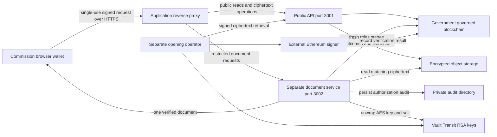
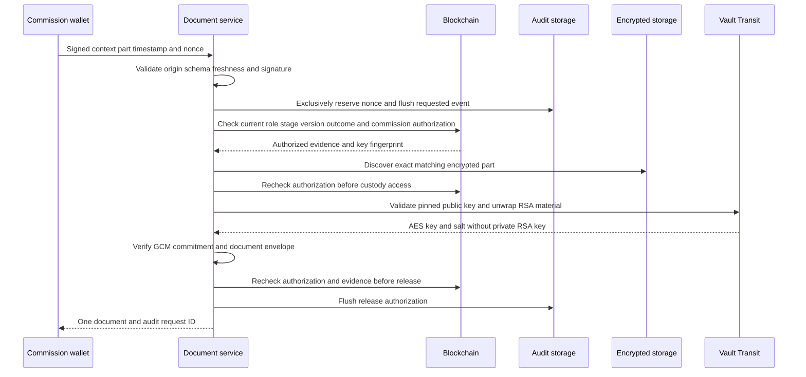

# Restricted document viewing and key custody

Implemented 3 November 2026. The assigned commission can request one verified bid document using a wallet signature. A separate loopback service decrypts it after blockchain checks and persists a single-use audit record. The public metadata and encrypted-storage API does not import custody or decryption modules. Use the revised opening policy 2 contracts and update deployment addresses before starting these services.

## Start the local document viewer

This laptop now has backend/.env.documents configured with the three existing matching development keys. The steps below also cover a fresh setup; do not overwrite an existing configuration unnecessarily.

Keep your existing node, deployment and encrypted bid storage. Do not regenerate keys for an already published tender: its fingerprints are immutable.

1. From the project root, run `npm run dev` for the existing API and frontend.
2. Copy `backend/document-service.env.example` to `backend/.env.documents`.
3. Set `CUSTODY_DIR` in that file to the **existing absolute private directory** printed by `keys:generate`. Its initial.pem, technical.pem and financial.pem must match the tender fingerprints. Leave `CUSTODY_PROVIDER=local` for this laptop demonstration. The shared backend/.env must explicitly specify CHAIN_ID=31337. Private files must be regular files, have no group/other permissions and cannot be symbolic links.
4. In a separate terminal run:

```bash
cd ~/Desktop/Capstone/Implementation/constructBlock
npm --prefix backend run documents:dev
```

5. Open http://127.0.0.1:5173, choose **Commission & approval**, connect the tender's assigned commission wallet and load the tender. Authorize opening as the assigned commission and run the opening worker. A Verified outcome is required; opening authorization alone does not release contents.
6. In **Restricted bid documents**, select the exact bidder, version and part. Review the target, then click **Sign and view this document**. This signs an access request, not a blockchain transaction. Each attempt needs a fresh signature. There is no automatic retry of a consumed authorization.
7. UTF-8 text/plain files appear as escaped text. Other files are offered as application/octet-stream downloads; HTML, SVG and PDF are not embedded. A download is a local confidential copy. Closing, reloading, switching wallets/networks or replacing the snapshot clears application references and overwrites owned byte buffers where practical. The application never puts document contents in localStorage, logs or its backend object store.

The document service is deliberately separate from `npm run dev` and has no silent key-file fallback. If it is not running, verified documents remain unavailable while public reads and workflow actions continue. The Vite development/preview proxy forwards `/api/documents` to port 3002 before the general `/api` proxy on port 3001. Changing DOCUMENT_PORT requires changing that proxy too. Production needs its own reverse proxy, not Vite hosting.

## Access policy

Only a currently authorized COMMISSION_ROLE wallet equal to the tender's assigned commission can view documents. Government administrator, opening-service, bidder, auditor and final-approver roles alone do not grant viewing access. Final approval uses recorded decision evidence; additional reviewer permissions would need a separate approved policy.

The service checks deployment, current role, unpaused state, reached deadline, active current version, recorded commission opening authorization, required stage, eligible admission/technical decisions, a Verified outcome and exact on-chain Evidence/fingerprint. Initial documents are available from InitialOpening onward; technical from TechnicalReview; financial from FinancialOpening. Selected, Approved and Rejected preserve access to already verified eligible parts. Open, Closed, Cancelled and Unsuccessful do not permit viewing. Commission role revocation blocks a new document release.

Authorization is checked before discovery, before loading a custody key and again after decryption. Ciphertext hashes, RSA OAEP SHA-256, AES-256-GCM and the salted contextual commitment are independently verified on every release. A corrupt object, failed integrity check, wrong key or service failure releases nothing and does not change contract outcomes. A chain update after the final check cannot retroactively revoke a response already sent; authorized recipients can retain copies.

## Signed requests and audit

POST `/api/documents/view` exists only on the separate service. It takes the exact fields `context`, `part`, `viewer`, `timestamp`, `nonce` and `X-Document-Signature`. The shared document-protocol module binds chain, workflow, tender, bidder, version, part, viewer, timestamp and a random 128-bit nonce to the signature. Requests expire after 60 seconds, permit at most five seconds of future clock skew, and are checked again for expiration before release. A storage or opening-service signature cannot be reused here.

A verified signature reserves a nonce using exclusive filesystem creation before chain authorization. The reservation persists across process restarts and concurrent workers sharing the same audit directory. Even a failed signed attempt consumes its nonce. Invalid/expired signatures are denied before reservation. Each mode-0600 `.jsonl` record contains request metadata plus requested, denied or release-authorized events; successful records include the authorization block and encrypted content ID. Contents, filenames, signatures, AES material and private keys are absent. Writes are flushed before response release; failure to create or flush an audit record denies access. These are authorization records, not proof that a human read a document.

Requests require the exact configured browser Origin, JSON and a maximum 8 KiB body. Responses set no-store/private, no-cache, nosniff and a restrictive CSP. There is no CORS wildcard. Per-IP limits are 20 requests/minute and 1000 active rate buckets per process. The audit directory is capped at 10,000 reservations; arrange controlled retention before it fills. Do not delete nonce reservations while their signatures could still be valid. Local logs are neither immutable nor independently signed; production requires protected centralized audit shipping and managed retention. Rate limits are process-local and need a gateway limit for multiple instances.

## Vault Transit custody integration

The application now supports a remote RSA unwrap provider. With `CUSTODY_PROVIDER=vault`, private opening keys remain inside Vault; the service reads public metadata and sends only wrapped AES-key/salt material to Transit. It validates non-exportable RSA 3072 keys with plaintext backup disabled, pins an explicit key version to its published SPKI fingerprint, and requests OAEP with SHA-256. Vault addresses require HTTPS, no embedded credentials or redirects, a 10-second timeout, and a restrictive regular token file with no group/other permissions or symbolic links. Tokens are reread per operation so a separately managed agent can replace them. Provider errors are sanitized and abort without a bidder Failed outcome; a remote invalid-RSA result is conservatively treated as an operational error because it is not reliably distinguishable from Vault policy/configuration failure.

The implementation uses [HashiCorp's Transit API](https://developer.hashicorp.com/vault/api-docs/secret/transit) and [RSA encryption support](https://developer.hashicorp.com/vault/docs/secrets/transit). It wraps existing browser-produced RSA ciphertext in the versioned Vault transit envelope. RSA keys must be provisioned in Vault before publishing tenders using their public fingerprints.

A government infrastructure administrator should provision a TLS-protected Vault with persistent storage, audited operations, authentication and backup/recovery procedures. Use administrative credentials only for provisioning. Example Vault CLI commands in an already authenticated administrative session:

```bash
vault secrets enable transit
vault write transit/keys/constructblock-initial type=rsa-3072 exportable=false allow_plaintext_backup=false
vault write transit/keys/constructblock-technical type=rsa-3072 exportable=false allow_plaintext_backup=false
vault write transit/keys/constructblock-financial type=rsa-3072 exportable=false allow_plaintext_backup=false
vault policy write constructblock-runtime backend/config/vault-policy.example.hcl
```

If the transit mount already exists, skip the enable command. Do not grant the runtime principal creation, rotation, export, backup or administrative permissions. Provision short-lived runtime credentials independently, preferably via Vault Agent/workload authentication. The example policy grants only read-key metadata and decrypt on the three named keys. The app does not issue or renew credentials and does not manage Vault administration.

Copy the document-service example to backend/.env.documents, set CUSTODY_PROVIDER=vault, remove CUSTODY_DIR and configure VAULT_ADDR, VAULT_TOKEN_FILE, VAULT_TRANSIT_MOUNT and a **new output path** for VAULT_KEY_MANIFEST. The token file belongs to the service account with mode 0600. From the root:

```bash
npm --prefix backend run keys:vault:export -- config/vault-key-bindings.example.json
```

This reads and verifies the pinned public keys, writes public-only SPKI files into OPENING_KEYS_DIR and creates the manifest with fingerprints/name/version. It does not export private material. Publish a **new tender** using the printed fingerprints. An old tender encrypted to local private keys still needs those old keys; changing an environment variable does not migrate encrypted bids. Keep previous Vault key versions available for existing tenders and do not raise their minimum decryption version until retention permits. The application deliberately never substitutes a latest version for a pinned version.

For production set NODE_ENV=production and DOCUMENT_ORIGIN to the exact HTTPS application origin. Put the document service behind the application HTTPS reverse proxy and provision its filesystem/secret permissions under a separate OS identity or container. Mount ciphertext read-only, a writable private audit directory and only the runtime Vault token/manifest. The public API must receive neither custody directory nor Vault token mounts. The viewer needs no Ethereum signing wallet; its chain provider only reads.

## Opening worker with remote custody and signing

The existing local opening helper remains limited to disposable chain 31337. The generalized operator command accepts the same custody provider used by the viewer and a separately managed Ethereum signing gateway. Copy `backend/opening-operator.env.example` to backend/.env.opening and configure its HTTPS storage and signer origins. The signer must be trusted, bound to the opening-service address and support the Ethereum JSON-RPC methods used by ethers, including accounts, personal_sign and sendTransaction. Opening-key custody and Ethereum transaction signing are separate responsibilities. This adapter does not deploy or configure the signing gateway.

```bash
npm --prefix backend run opening:verify -- --tender 1 --bidder BIDDER_ADDRESS --version 1 --part initial --actor OPENING_SERVICE_ADDRESS
```

The worker verifies signer/deployment agreement, service role and the opening state, retrieves signed ciphertext, invokes custody, simulates the outcome call and verifies its receipt. Pending hashes and result reports are persisted under backend/reports/openings. It never imports a wallet private key. HTTP is permitted only for loopback origins on chain 31337; production requires HTTPS. Infrastructure errors do not cause a Failed bidder outcome. Reconcile a printed pending transaction hash before retrying.

## Architecture and release flow





Local demonstration uses private PEM files instead of Vault. Process separation on a laptop is not isolation from that laptop's administrator. Vault reduces RSA-key exposure but a compromised runtime token can invoke decrypt outside this application's chain gate. Commission opening authorization remains software-enforced; this is not threshold RSA, hardware-enforced dual control, an HSM deployment or a production security certification.

## Verification and deployment boundary

Run `npm run build`, `npm test`, `npm --prefix contracts test`, `npm run test:documents`, `npm run test:opening`, `npm run test:storage` and `npm run test:award` from the root. The document integration uses genuine encrypted files, isolated contracts, signed HTTP handlers and the actual frontend client. Unit tests include Vault metadata/policy/fingerprint validation, browser RSA interoperability through a simulated Vault API, no silent fallback, symlink rejection, replay/concurrency, post-decryption revocation, audit failure and HTTP limits.

A live Vault server, TLS proxy, secret agent, protected OS deployment and remote signing gateway have **not** been provisioned or exercised. Docker is installed on this laptop but its daemon was unavailable during this task. The separate document process started using the existing local keys, but the workspace denied its loopback HTTP connection with EPERM. Full live HTTP transport, real wallet dialogs, interactive browser clicks, disaster recovery and security assessment remain deployment checks. Malware scanning, tamper-resistant centralized audit, production identity mapping, thresholds/HSM custody, offsite backups, real public-extract publication and durable indexing/recovery are separate work.

## OrbitDB adapter added 13 November 2026

Encrypted persistence can now be selected with `STORAGE_PROVIDER=orbitdb`. The adapter stores actual encrypted part contents in database records and uses a separate local owner process shared by the API and restricted viewer. There is no replication workflow. Filesystem storage remains explicitly selected while external dependency installation and live validation are pending. See [setup and verification](OrbitDB_Encrypted_Storage.md).
